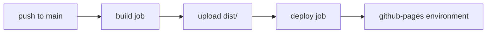

# Deploying to GitHub Pages

`.github/workflows/deploy-pages.yml` publishes the Vite build on every push to `main`.

## Jobs

- `build`: checks out, installs pnpm 10 and Node 22 with the pnpm cache, runs `pnpm install --frozen-lockfile` and `pnpm build`, then uploads `dist/` as the Pages artifact. The build emits asset URLs under `/quill/`.
- `deploy`: needs `build`, holds `pages: write` and `id-token: write`, and runs `actions/deploy-pages` into the `github-pages` environment.

A `pages` concurrency group cancels an older run when a newer push arrives. Workflow-level permissions are `contents: read`.

## Repository setting

The repo's Pages source must be set to GitHub Actions. This is a repo setting a commit cannot make; at audit time it was still a branch source (`main`, `/`), so the deploy does not publish until a person changes it.
